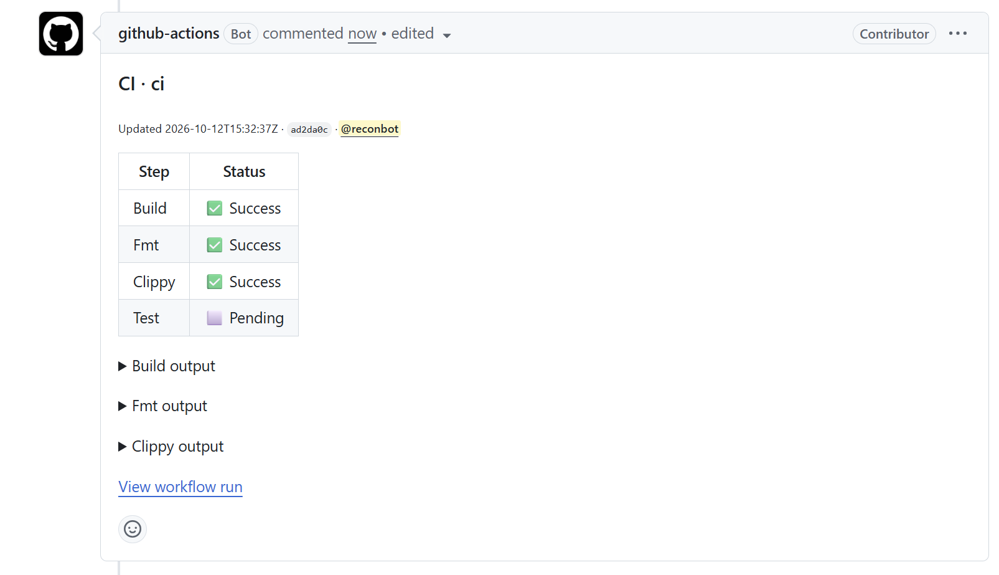
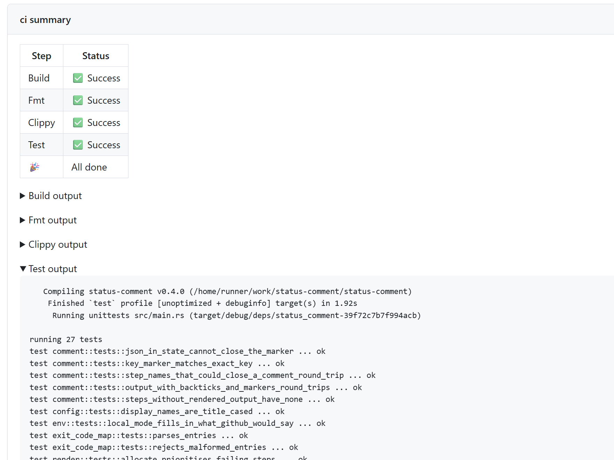

# Status Comment

Keeps a pull request comment up to date with steps of a GitHub Actions job's. Record commands status and outputs for easy viewing. Also updates the job summary. Customizable with a [minijinja template](https://github.com/mitsuhiko/minijinja). This repo contains both the cli and the github action.




## Installation

### GitHub

In a workflow, this repo is also an action that installs the binary from the same release and puts it on `PATH`:

<!-- x-release-please-start-version -->

```yaml
permissions:
  pull-requests: write
steps:
  - uses: reconbot/status-comment@v0.6.0
    with:
      token: ${{ github.token }}
  - run: status-comment steps set build test
  - run: status-comment exec build 'cargo build'
  - run: status-comment exec test 'cargo test'
```

The `token` input is saved to the config, so every later call uses it, the end-of-job `finalize` included, and no other step sees it. Instead, you can set `GITHUB_TOKEN` at the job level so `finalize` sees it too:

```yaml
env:
  GITHUB_TOKEN: ${{ github.token }}
```

To load a config file, give its path; a `token` input is applied after it:

```yaml
steps:
  - uses: reconbot/status-comment@v0.6.0
    with:
      config-path: .github/status-comment.json
      token: ${{ github.token }}
```

<!-- x-release-please-end -->

Both inputs write to the default state directory. If you use `--state-path`, run `config load` and `config set token=…` with it yourself.

At the end of the job, even a failed one, the action runs `status-comment finalize` for you. It does nothing if no Steps were recorded, and never fails the job. Set `with: finalize: false` to call `finalize` yourself instead. Builds exist for Linux x86_64, Linux arm64 and macOS arm64; each release also has them as `status-comment-<target>.tar.gz`.

### Local

```bash
cargo install status-comment
```

## CLI Usage

```bash
# Set the Steps, in order, pending by default
status-comment steps set init validate plan apply

# Name a Step and label a Custom Status for the next update
status-comment config set step.plan='Terraform Plan' status.changes.display='🔍 Changes detected'

# Use your own minijinja Template with
status-comment config set template=.github/terraform-comment.md.j2

# Run a command: the Step shows `running`, then the exit code picks its Status
status-comment exec plan --exit-code-map 0=success,1=failure,2=changes 'terraform plan -detailed-exitcode'

# Set a Status of a step directly, then pipe the output to
status-comment step validate --status success

# Pipe output of a command to the output of the step
./init.sh | status-comment init apply

# Mark the run as finished (automatically done with the action)
status-comment finalize

# Preview the comment with current settings and output
status-comment preview
```

`status-comment --help` lists the commands; `status-comment <command> --help` shows each one's options.

## Commands

| Command | What it does |
|---|---|
| `steps set <name>...` | Set the Run's Steps, in order. Unlisted Steps are removed; listed ones keep their Status; new ones start `pending`. Reopens a finalized Run. |
| `steps --reset-status` | Set every Step back to `pending` and clear its Output. Reopens a finalized Run. With `set` (`steps set a b --reset-status`), the list is applied first. |
| `step <name> [--status <status>]` | Set a Step's Status (default `success`). Piped stdin becomes its Output. Unknown Steps are appended. |
| `exec <name> <command> [--exit-code-map <code=status,…>]` | Mark the Step `running`, run `<command>` under `bash -o pipefail`, set the Status from the exit code. Default map: `0=success`; unmapped codes are `failure`. |
| `finalize` | Close out the Run: `pending` → `skipped`, `running` → `cancelled`; write the job summary. |
| `config list` | Print the current config. |
| `config set <key>=<value>...` | Change one or more keys and print the result. |
| `config load <file>` | Replace the config with a JSON file and print the result. Relative `template` paths resolve against that file's directory. |
| `preview [--target comment\|summary]` | Print the whole stored comment exactly as saved, hidden markers included (default), or the job summary it would produce. Changes nothing. |
| `default-template` | Print the built-in Template for hacking yourself. |

Every command also takes `--state-path <dir>` (where `config.json` lives, and `comment.md` when there's no PR; default `$RUNNER_TEMP/status-comment`, or `.` in Local Mode) and `--token <token>` (default: the config's `token`, then `$GITHUB_TOKEN`).

### Config keys

The first command to run (any but `default-template`) creates `config.json` in the state directory.

| Key | Default | Meaning |
|---|---|---|
| `template` | `default` | `default` for the built-in Template, or a Template file path, saved as absolute. Later edits to the file apply. |
| `comment-key` | "$GITHUB_WORKFLOW/$GITHUB_JOB" on GitHub; `local` in Local Mode | Key to find the comment to update. |
| `status.<status>.display` | `status.success.display=✅ Success` and the like for each Built-in Status | How a Status is shown. Any Status can have one, e.g. `status.changes.display='🔍 Changes detected'`; without one, a Custom Status shows as its name. |
| `status.<status>.show-output` | `true` for `failure` and `cancelled`; `false` for the other Built-in Statuses | `true` or `false`: whether the default Template shows a Step's Output expanded instead of collapsed. Any Status can have one; without one, Output is collapsed. |
| `step.<step>` | none: the title-cased name (`rules-check` → `Rules Check`) | A Step's display name, e.g. `step.rules-check='OPA Rules'`. |
| `token` | none | GitHub token. `--token` beats it; it beats `$GITHUB_TOKEN`. `config load` replaces it like any other key. |

An empty value (`step.rules-check=`) resets any key to its default.

If using a matrix in your workflow and want different comments you might want to append something from the matrix:

```bash
status-comment config set comment-key="$GITHUB_WORKFLOW/$GITHUB_JOB/${{ matrix.setting }}"
```

Jobs that share a Comment Key each need the same labels; keep them in a checked-in file and pass it as the action's `config-path` in every job.

## Statuses and exit codes

| Status | Meaning | Set by | Failing |
|---|---|---|---|
| `pending` | Not started | `steps set` for new Steps; `steps --reset-status` | |
| `running` | In progress | `exec` while the command runs | |
| `success` | Finished cleanly | An exit code mapped to it (default `0`); `step` by default | |
| `failure` | Finished with an error | Any unmapped exit code | ✓ |
| `skipped` | Never ran | `finalize`, from `pending` | |
| `cancelled` | Interrupted | `finalize`, from `running` | ✓ |

Any Built-in Status can also be set with `step --status` or `--exit-code-map`. Anything else is a Custom Status (e.g. `changes`): no meaning to the tool, never Failing, rendered by the Template.

- `exec` exits `0` unless the Status is Failing. An unmapped exit code passes through; a mapped Failing one exits non-zero.
- `step` and `exec` append `status=<status>` to `$GITHUB_OUTPUT`.
- An error reading or writing the Status Comment (fork PRs, missing `pull-requests: write`, rate limits) prints an error annotation and ends status-comment's own work for that call: no comment update, `$GITHUB_OUTPUT` line or job summary. The exit code is left alone, and `exec` still runs its command.

## How it works

- Creates and updates a comment on the PR. State is stored in the comment so different jobs may update different steps.
- A new run ID starts the Steps fresh; re-run attempts keep them.
- Long outputs get truncated to stay under the comment character limit, prioritizing Steps whose Status has `show-output`.
- Leaves a job summary on finalization.

## Local Mode

When `GITHUB_ACTIONS` isn't `true`, status-comment runs in **Local Mode** so you can try commands and Templates on your machine:

- It never calls GitHub.
- The state path defaults to the current directory, so you get `./comment.md` and `./config.json`. The Comment Key defaults to `local`.
- Each command that changes Steps prints the rendered comment to stderr; warnings and errors are plain stderr lines.
- A Run ends at `finalize`; the next `steps set`, `step` or `exec` starts a new one.

```bash
status-comment steps set lint test deploy
status-comment exec lint 'cargo clippy'
status-comment exec test 'cargo test'
status-comment finalize
```

## Templates

Templates are [minijinja](https://github.com/mitsuhiko/minijinja) (Jinja2) files, rendered without HTML escaping. The default is [`src/default_template.md.j2`](./src/default_template.md.j2).

| Variable | Contents |
|---|---|
| `steps[]` | `name`, `display_name`, `status_label` and `show_output` (from the config), `status`, `failing`, `has_output` (false when the Output is missing or only whitespace) |
| `run` | `id`, `attempt`, `url`, `failing`, `finalized` |
| `github` | `workflow`, `job`, `actor`, `repository`, `sha`, `short_sha`, `pr_number`, `pr_url`, `server_url`, `updated_at` |
| `target` | `"comment"` or `"summary"` |

Render Output with `{{ step | output }}`, the only way to reach it: the filter's markers are how the next call reads it back ([ADR 0001](./docs/adr/0001-state-lives-in-the-status-comment.md)). Booleans print as `True`/`False`; branch on them with ``.

## Data model

The hidden JSON at the bottom of the Status Comment. Simplified from [`src/state.rs`](./src/state.rs) and [`src/status.rs`](./src/status.rs):

```rust
struct State {
    /// The status-comment version that wrote it; another version's State is never read.
    version: String,
    /// A different run ID starts a fresh State. Always `local` in Local Mode.
    run_id: String,
    /// The re-run attempt that last wrote it; older runs and attempts never overwrite it.
    attempt: u32,
    /// Set by `finalize`; cleared by every other command that changes Steps.
    finalized: bool,
    steps: Vec<Step>,
}

struct Step {
    /// Identity, from `steps set`, `step` or `exec`.
    name: String,
    status: Status,
    /// Merged stdout and stderr. Never serialized: it lives only in the rendered comment.
    output: Option<String>,
}

/// Serialized as a plain string: "success", "changes", …
enum Status {
    Pending,
    Running,
    Success,
    Failure,
    Skipped,
    Cancelled,
    Custom(String), // e.g. "changes"
}
```

## License

[Apache-2.0](./LICENSE)

## Development

The Rust toolchain is pinned with [mise](https://mise.jdx.dev):

```bash
mise install
git config commit.template .gitmessage   # commit types cheat sheet
mise exec -- cargo test
mise exec -- cargo clippy --all-targets
```

Releases are cut by [release-please](https://github.com/googleapis/release-please) from [Conventional Commits](https://www.conventionalcommits.org/) (`feat:`, `fix:`) on `main`.
